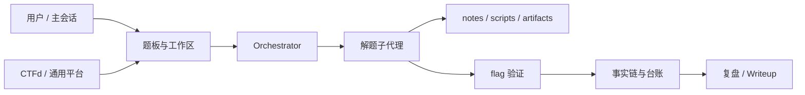

# dsh-ctf-auto

> DeepSeek Harness 的 CTF 自动解题编排插件：题面 / 附件 / 平台题目 → 单题工作区 → 子代理自主解题 → 事实链、尝试记录、flag 台账与复盘。

`dsh-ctf-auto` 把 CTF 解题拆成一条可观测、可恢复、可审计的流水线：主会话负责建题和调度，子代理在独立目录里侦察、分析、验证，每轮尝试都会留下事实、失败路径和证据。插件同时提供一个完整的 Web 题板，支持平台导入、工作台编辑、知识检索、打法记忆、报告和 Writeup 导出。

当前版本：`0.1.0`，包名 `@dsh-external/dsh-ctf-auto`。

---

## 特性一览

- **Agent 模式**：注册 `ctf-auto`（「CTF 自动解题」）模式，在会话里直接贴题即可派发解题子代理。
- **多轮编排**：并发队列、单次超时、整题预算、预算结算、自动换角度重试、重启恢复。
- **独立工作区**：每题一个目录，包含 `statement.md`、`notes.md`、`files/`、`scripts/`、`artifacts/`。
- **工作区界面**：总览、卡片/列表/看板、九个单题分区、可视化前置实验、快捷查找、深浅主题与容器响应式布局。见 [界面与前端开发](docs/UI-WORKSPACE.md)。
- **可观测过程**：attempts、facts、events、failedPaths、flag evidence 全部写入状态库并展示在面板。
- **实验黑板**：持久化假设、测试范围、预期、实测和证据摘要；支持/证伪需证据，重开需新增变量和新证据，重试自动继承。见 [实验黑板与 Muteki 参考设计](docs/EXPERIMENT-BOARD.md)。
- **按假设派工的蜂群**：默认关闭；协调者从实验黑板派出最多两个辅助代理，离线分析可并行，靶机实验串行，共用本题预算；支持前置依赖、证据就绪后续派和争议独立复验，统一停止和核验。见 [蜂群设计与使用](docs/SWARM.md)。
- **靶机环境串行**：容器题同一时刻只跑一个，解出/收口后自动销毁环境，配额满时先回收残留再重试。
- **三平台适配**：CTFd、通用 JSON 与 DASCTF 开放 API（Bearer Token）；支持平台自动探测、按题导入、提示解锁、flag 提交回显。
- **安全边界**：子代理只能操作自己的题目；全局平台/配置/宿主工具仅主会话可用；工作台拒绝符号链接逃逸。
- **知识层**：BM25 段落检索、行号与内容摘要引用、重复资料合并；区分原始笔记与可自动参考的资料。见 [记忆与知识库机制](docs/LEARNING.md)。
- **记忆层**：从可核验实验沉淀步骤和带范围的负结果；来源变化后暂停召回，支持绑定实际尝试与版本的实测反馈，区分召回后解出与资料有用。
- **会话证据导出**：一键下载当前工作区主会话、解题与蜂群子会话的原始 JSONL 和关联附件；每题独立目录，附会话关联与缺失清单。见 [SESSION-EXPORT.md](docs/SESSION-EXPORT.md)。
- **复盘交付**：Markdown 报告、单题 Writeup、包含脚本/产物的 tar.gz 打包。
- **可移植打包**：自带题型卡、角色卡、脚本和测试；外部 `ctf-solver` 技能目录缺失时仍可加载自带题型卡。

---

## 工作方式



一次完整的题目生命周期：

1. `ctf_solve_start` 或面板新建题目。
2. 状态库登记题目，创建独立目录并复制附件。
3. Orchestrator 按并发上限派发子代理。
4. 子代理在题目目录内侦察、实验、写脚本并验证 flag。
5. 验证通过后调用 `ctf_flag_record`；平台题也可以走 `ctf_platform_submit` 获取平台回显。
6. 失败时记录卡点和已试路径，自动换角度重试；退出或崩溃后可由下次启动恢复。

---

## 安装

### 前提

- DeepSeek Harness Desktop，能正常使用 Agent 模式和子代理。
- Node.js `>=20`。
- 推荐准备一个可用的 `ctf-solver` 技能来源目录，以便加载外部模块技能；没有该目录时，插件自带的 4 张题型卡仍然可用。
- 可选安装 `@dsh-external/dsh-scanner-tools`；未安装时 preset 会自动跳过 scanner 行。

### 从本地目录安装

将本目录作为 DSH bundle 安装到当前 profile，把路径替换成你的实际绝对路径：

```text
plugin_manager action=install_bundle target=<absolute-path>/dsh-ctf-auto
```

安装或更新宿主代码后，按 DSH 的要求重新加载插件。首次使用建议先在主会话运行：

```text
ctf_solve_doctor()
```

### 从 tarball 安装

```bash
npm pack
```

生成的 `.tgz` 已包含 `lib/`、`assets/`、`test/`、`docs/` 和 `LICENSE`。随后使用 DSH 的 plugin manager 安装该 tarball，或使用对应 profile 的包管理命令安装。

> 插件不会自动安装外部 `ctf-solver` 技能目录。该目录缺失时，内置题型卡仍能工作，但部分模块技能会回退到通用 `ctf-playbook`。

---

## 快速开始

### 1. 使用 Agent 模式

新建会话时选择模式 **「CTF 自动解题」**，然后直接贴题面、附件路径或目标地址。模式人设会把题目交给编排器，而不是在主会话里反复手工操作。

### 2. 使用会话视图

在对话顶部打开 **「CTF 自动解题」**，再进入内部标签页：

| 标签 | 用途 |
|---|---|
| 题板 | 题目状态、筛选、分组、工作台、开始/停止/重试 |
| 平台 | CTFd / 通用平台配置、拉题、导入、提示和提交 |
| 调度 | 并发队列、运行中尝试、预算和最近完成情况 |
| 台账 | 按状态/模块统计和 flag 证据 |
| 复盘 | Markdown 报告、Writeup 历史与预览 |
| 知识 | 私有知识库导入和检索 |
| 记忆 | 打法卡、事实流和沉淀操作 |
| 设置 | 运行时配置、诊断和模型参数 |

### 3. 主会话直接调用工具

```text
ctf_solve_start(
  title="Example Crypto",
  category="crypto",
  statement="题面全文……",
  files=["/absolute/path/to/challenge.zip"],
  maxAttempts=3,
  timeBudgetMinutes=20
)
```

返回题目 id 后：

```text
ctf_solve_status()
ctf_solve_status(id="c-...")
ctf_solve_log(id="c-...")
ctf_solve_retry(id="c-...", hint="尝试从 RSA 共模攻击方向入手")
```

`timeBudgetMinutes` 是**单题总预算**，从第一次尝试开始计时；实际单次尝试仍受全局 `timeoutMs` 限制。

### 4. 导入平台题目

在「平台」页填写地址和 Token 后：

```text
ctf_platform_status()
ctf_platform_import(ids=["uuid-or-id"], start=true)
```

导入时会按当前会话工作区落盘。未设置 `start=true` 的题目会以 `stopped` 状态创建，等待手动开始。通用平台的字符串/UUID ID 会按原样保留。

---

## 配置

### row 配置：`cordis.patch.yml`

| 键 | 默认值 | 说明 |
|---|---:|---|
| `concurrency` | `2` | 同时运行的解题子代理上限 |
| `timeoutMs` | `1800000` | 单次尝试超时，超时后中断并收口为 `timeout` |
| `maxAttempts` | `3` | 单题最多尝试次数（含第一次） |
| `autoRetry` | `true` | 失败或卡住后自动换角度重试 |
| `solverPreset` | `ctf-auto` | 子代理使用的 Agent preset |
| `solverModel` | `""` | 子代理模型；留空跟随默认 |
| `escalateModel` | `""` | 第二次及后续尝试使用的模型 |
| `rootDir` | `""` | 题板数据根目录；留空为 `~/.dsh/ctf-auto` |
| `wrapupRatio` | `0.8` | 预算结算触发比例，范围 `0.5`–`0.95` |
| `wrapupGraceMs` | `120000` | 结算宽限时间 |
| `reviewerEnabled` | `false` | 是否自动启动独立复核子代理 |
| `flagPatterns` | `[]` | 自定义 flag 形态正则 |
| `minEvidenceChars` | `12` | evidence 最短字符数 |
| `memoryTopK` / `memoryMinScore` | `3` / `0.3` | 打法卡召回参数 |
| `knowledgeTopK` / `knowledgeMinScore` | `3` / `0.08` | 知识片段召回参数 |
| `pricePerMToken` | `2` | 费用估算单价 |
| `autoDistill` | `true` | 解出后自动沉淀打法卡 |

其中大多数配置可以在面板「设置」页运行时修改，写入 `<rootDir>/config.json`。运行时修改主要影响后续尝试；题目创建时记录的 per-challenge 预算仍优先。

### 数据目录

```text
<session cwd>/.ctf-auto/<slug>/
  statement.md
  notes.md
  files/
  scripts/
  artifacts/
  flag.json

~/.dsh/ctf-auto/
  state.json
  platform.json
  config.json
  memory.json
  knowledge/
  writeups/
  reports/
  packages/
```

插件会在题目工作区下自动创建忽略规则，避免把 `.ctf-auto/` 中的笔记、附件和 flag 误提交到 Git；仍建议在使用前检查项目自身的 ignore 配置。

状态库写盘失败时，题板会显示未保存提示，写操作返回 `ok=false`、`applied` 和 `persistence` 信息；`applied=true` 表示操作已执行但状态尚未持久化，不应重复执行。后台会重试保存，也可通过 Web 通道 `state.flush` 主动重试。磁盘仍不可写时，新写操作会被阻止；这不是事务回滚机制。状态文件读取失败、版本过新或损坏文件无法备份时，会保留原文件并报错。

知识检索支持中文双字词组和英文/代码标识符，查询可匹配标题、分类、标签及正文。自动召回按重叠段落评分，提示词使用命中段落，并缓存未变更段落的分词结果；目前仍使用本地关键词检索。

状态库、平台配置、运行时配置和导出物使用受限文件权限；平台 Token 当前以本地明文保存，敏感环境请自行限制账号和文件访问。

---

## 工具权限

插件当前提供分组化的 `ctf_*` 工具。主会话可以使用全局工具；解题子代理只允许操作自己的题目目录。

### 主会话可用工具

- **编排**：`ctf_solve_start`、`ctf_board_import`、`ctf_solve_status`、`ctf_solve_stop`、`ctf_solve_retry`、`ctf_solve_log`、`ctf_solve_doctor`
- **平台**：`ctf_platform_status`、`ctf_platform_import`、`ctf_platform_submit`、`ctf_platform_reconcile`、`ctf_platform_detect`、`ctf_platform_hints`
- **管理与导出**：`ctf_challenge_remove`、`ctf_report_export`、`ctf_writeup_export`、`ctf_writeup_pack`、`ctf_review_flag`
- **输入与本地恢复**：`ctf_challenge_prepare`（在原记录中重试输入准备）、`ctf_challenge_sync`（主会话修复文件后立即重试同步）
- **任务管理**：`ctf_tasks`、`ctf_task_cancel`、`ctf_task_resolve`（主会话查看任务、请求取消及核对旧执行端）
- **工作台/检索（主会话和子代理共享）**：`ctf_workbench_list`、`ctf_workbench_read`、`ctf_workbench_write`、`ctf_search`、`ctf_triage`
- **知识/记忆**：`ctf_kb_import`、`ctf_kb_search`、`ctf_recall`、`ctf_memory_list`、`ctf_memory_distill`
- **诊断与调度**：`ctf_schedule`、`ctf_target_probe`、`ctf_wsl_run`

### 子代理工具

子代理按 `cwd` 绑定到当前题目，只能使用：

- 自己的工作台：`ctf_workbench_list`、`ctf_workbench_read`、`ctf_workbench_write`
- 自己的实验黑板：`ctf_experiments`、`ctf_experiment_record`（有证据的假设结论不等于 flag 已验证）
- 自己的附件分诊和目标探测：`ctf_triage`、`ctf_target_probe`
- 自己的题板检索：`ctf_search`
- 自己的 `ctf_flag_record`
- 自己的 WSL 工作目录：`ctf_wsl_run`（cwd 和题目绑定会被强制到当前题目）
- 只读的知识/记忆召回：`ctf_kb_search`、`ctf_recall`

平台导入、提示解锁、平台提交、平台配置探测、全局知识导入、记忆沉淀和复核等副作用不会暴露给子代理；WSL 是例外，但只能使用当前题目目录。

### flag 验证规则

- `verified=true` 会先检查 flag 形态和 evidence 长度/占位词。
- `method=platform` 只能由宿主完成平台提交回显后使用，模型直接自报无效。
- `local-check` / `derivation` 仍依赖子代理提交的复现证据；高保证场景应使用平台回显或开启独立复核。
- 开启 `reviewerEnabled` 后，本地验证候选须逐个通过复核，才自动提交并沉淀记忆；已获平台 correct 回显的证据不被模型复核撤销。
- 复核绑定候选及证据版本，期间变更会使旧结果失效；同题并发复核合并，异常最多自动重试 3 次并退避。复核期间保留靶机，重试耗尽后允许释放环境，但不沉淀未通过的记忆。
- 复核拒绝会降级对应本地候选、同步更新或删除 `flag.json`，并清除该题已有打法卡。
- 平台题的本地校验保存为 `localVerified=true` 的待提交候选，不直接置为已解；平台正确回显或独立复核后才升级。
- 平台明确拒绝的候选标记 `rejected=true` 并撤销验证；自动提交不会重复重放该候选。
- `verified=false` 的候选 flag 不会把题目置为已解。

---

## 全自动流水线（拉题 → 解题 → 提交）

- 题板右上角「**全自动跑板**」：从当前平台拉取未解题 → 导入 → 立即入队开始；解出后按设置自动提交 flag。
- 设置页「**自动化**」卡：周期自动拉题（间隔/每轮题数）、导入后自动开始、解出后自动提交（默认开）。
- 对应端点 `pipeline.run`（支持 `dryRun` 预览候选）；自动提交结果写入 `challenge.platformSubmit` 与事件。

## 存储路径（跨会话持久）

- 记忆：默认 `~/.dsh/ctf-auto/memory/memory.json`
- 复盘：默认 `~/.dsh/ctf-auto/reports/`（Writeup 在 `reports/writeups/`）
- 设置页「存储路径」可改成任意目录；首次启用时会自动把旧数据复制过去，会话/题板重建也不影响。

## 平台接入

平台工作流已重构为连接检查、发现选择、准备入队与平台确认。页面按服务器列表快照导入，支持同 ID 不同来源的独立选择。接口、兼容与恢复说明见 [PLATFORM-WORKFLOW.md](docs/PLATFORM-WORKFLOW.md)。

平台核心拆分为连接服务（适配器与客户端生命周期）、操作协调器（资源串行与并发请求合并）和提交服务（验证回显与提交记录），工具和面板共用业务入口。连接配置变更会清理客户端缓存；同一配置复用客户端及 MCP 会话。CTFd 的提交和付费提示解锁不再自动重试；MCP 会话过期时只自动重放明确的只读操作。架构与边界见 [平台核心架构](docs/PLATFORM-ARCHITECTURE.md)。

平台导入按来源平台、赛事/练习场、赛段和题目 ID 去重，各工作区可分别导入；同名题不会被直接跳过。切换平台配置后，旧题的提交、刷新和环境操作要求切回原连接，避免将当前 Token 用于其他平台。当前只保存一套活动平台配置。

本地 verified flag 会触发自动提交；平台回显为 correct 后记录平台验证证据。网络错误后的提交可在服务恢复后重新登记 flag 重试。DASCTF 的地址可留空使用默认 MCP 端点，Token 可仅通过 `CTF2_AGENT_TOKEN` 提供。

### CTFd

面板填写：

- `baseUrl`：例如 `https://ctfd.example.com`
- `apiToken`：CTFd API Token

支持：

- 查看账号与连接状态
- 拉取题目、详情和附件
- 按题目 ID 导入
- 解锁并记录 hints
- 提交 flag 并根据平台回显自动登记

CTFd API Token 只在同源请求中发送；外部 CDN/S3 附件不会携带平台 Token。

### 通用 JSON 平台

选择适配器模式 `generic`，填写 profile。最小示例：

```json
{
  "listPath": "/api/challenges",
  "detailPath": "/api/challenges/{id}",
  "submitPath": "/api/challenges/{id}/submit",
  "submitMethod": "POST",
  "submitBodyField": "flag",
  "map": {
    "list": { "dataPath": "data", "id": "id", "name": "name", "category": "category", "files": "files", "solvedByMe": "solved_by_me" },
    "detail": { "dataPath": "data", "description": "description", "connectionInfo": "connection_info" },
    "submit": { "statusPath": "data.status", "messagePath": "data.message", "okStatuses": ["correct", "accepted"], "alreadyStatuses": ["already_solved"] }
  }
}
```

通用适配器支持字符串 ID、Bearer Token/API Key、自定义鉴权头、嵌套提交体，以及有上限的页码分页；前端提供分页、根数组、API Key 模板。配置示例见 [平台工作流](docs/PLATFORM-WORKFLOW.md)。列表字段映射不是数组时会报错，已解状态可通过 `map.list.solvedByMe` 配置（仅布尔值 `true` 表示已解）。DASCTF 每次请求最多 200 项，达到上限时会提示列表可能不完整；当前接口未提供可用分页时不能保证遍历全部题目。附件自动下载仍只对 CTFd 提供，通用平台请在题面中提供可手动处理的附件地址。

### DASCTF 开放 API（MCP / REST）

自研框架通过 MCP（HTTP JSON-RPC）接入：端点默认 `https://ctf2.dasctf.com/api/ai/v1/mcp`，请求头
`Authorization: Bearer $CTF2_AGENT_TOKEN`；连接后可用全部 24 个工具（练习/比赛题、附件、提交、靶机环境、
whoami、笔记等）。

面板选择适配器模式 `dasctf`，填写：

- `apiToken`：`CTF2_AGENT_TOKEN`（留空时读取同名环境变量）
- `baseUrl`：可留空（默认 `https://ctf2.dasctf.com`）
- `mcpUrl`：可留空（默认 `<baseUrl>/api/ai/v1/mcp`）

点「自动探测平台」会用 whoami 验证连通并显示可用工具数；导入/提交/靶机环境与 CTFd 流程一致：
`platform.status` 走 whoami，拉取题板走 `ctf2_agent_next_challenges`，详情/附件/提交按题目来源自动选择
练习或比赛工具；靶机用 `ctf_platform_env`（start/status/extend/delete）管理。

---

## 核心生命周期

题目摘要与详情新增 `lifecycle`，将执行、验证、提交和环境状态分别表示；原 `status` 保留兼容。`state.get` 与题板状态工具还返回 `lifecycleTotals`，可区分平台确认、待复核和提交未决的题目。单题工具和 Web 写操作共用题目应用服务。

提交结果未知、平台拒绝候选或仍有复核/提交进行时，不再仅凭 `solved` 自动沉淀成功经验；提交未决时保留环境，等待人工处理。实现范围和后续边界见 [题目生命周期与业务入口](docs/CHALLENGE-LIFECYCLE.md)。

平台提交增加每题持久化流水：发送前保存阶段，平台结果先落盘，再更新 flag 和本地文件。进程中断后的未决请求不会自动重发；使用面板「核对平台结果」或 `ctf_platform_reconcile({id})` 查询。平台已解只收口题目状态，不证明某个 flag 正确。确需重提时显式允许重复提交，旧未决记录仍保留；详见 [提交流水与中断恢复](docs/SUBMISSION-RECOVERY.md)。

状态库增加只读快照与单题事务，将 flag、事实、事件和关联状态放在同一草稿中修改后一次保存，并通过内容修订检查拒绝旧快照覆盖新内容。flag 登记、候选移除、复核结果、提交流水及调度器尝试生命周期已迁入，宿主其他模块的旧接口仍保留；详见 [状态快照与单题事务](docs/STATE-TRANSACTIONS.md)。

调度器为新尝试分配 `runId`，统一保存创建和收口信息，校验迟到结果及会话绑定。保存失败时暂停新派发并保留进程内待收口计划；单次超时、整题运行预算、看门狗和倒计时使用单调时钟，日期仅作审计和预计展示。检查点与重启恢复边界见 [预算计时](docs/BUDGET-TIMING.md) 和 [调度器事务与尝试身份](docs/SCHEDULER-TRANSACTIONS.md)。

原单题写接口已统一经过事务，失败抛出明确的 code/applied。公共 get/list/state、查找和创建结果也已改为冻结快照，提交与环境服务使用显式实体身份并重读最新状态。靶机探测、分类和提示登记已合并业务事务。迁移规则见 [只读状态接口](docs/READ-ONLY-STATE.md)。

解题并发及靶机串行按未决任务和本地资源占用计算。超时、取消或重启后，未确认结束的 solver 继续占用名额；面板与 `ctf_schedule` 显示实际占用和「待确认结束」任务，核实停止并收口后才释放。

解题、复核、提交和环境操作共用进程内资源占用，删除环境需要排他占用并重新检查自动清理资格。环境创建、续期和删除增加持久化流水，未决请求不自动重放；面板「核对环境」支持查询和显式接受稳定观测。详见 [资源占用与环境操作恢复](docs/ENVIRONMENT-RESOURCES.md)。

四类任务进一步接入持久化登记、实例身份、心跳和取消请求。重启及租约超时后，无法确认结束的任务保留为待核对，阻止重跑和环境清理，不按超时自动释放。详情新增「任务与租约」，主会话可用 `ctf_tasks`、`ctf_task_cancel`、`ctf_task_resolve` 管理。已发送的平台操作仍记录真实回显；实现边界见 [统一任务登记、租约与取消](docs/TASK-LEASES.md)。

本实例租约使用单调时钟，已观察到的过期不再续租；写入锁失效或状态文件冲突会保持实例写入屏障并请求中断旧任务。执行端缺少有效完成 Promise、返回异常或等待被拒绝时保留未知状态，不能据此判定远端已经停止。真实宿主行为仍待运行验证。

平台题面刷新已拆出独立服务，异步返回会检查题目与连接是否变化。附件写入新路径并保留旧文件，题面和文件同步待办一起保存；statement.md 写入失败可后台恢复，同步完成前暂停解题与复核。详见 [平台刷新与文件恢复](docs/PLATFORM-REFRESH.md)。

新建及初次导入增加持久化输入准备阶段，附件、题面和笔记确认前不会派发；中断记录可用面板「重试输入准备」或 `ctf_challenge_prepare({id})` 在原记录上恢复，完成后仍需显式开始。恢复重新读取本地来源或重新下载平台附件，保留笔记、脚本和产物。会话移除使用一次批量状态提交，成功后才尝试检查归属并清理目录，失败保留文件。规则见 [题目准备与批量移除](docs/CREATION-REMOVAL.md)。

创建、平台导入与准备重试已拆为独立服务；宿主提供会话授权和工作区上下文，排队前固定请求快照，首次导入与重试共用附件列表确认规则。职责与关闭顺序见 [输入服务与宿主边界](docs/INPUT-ARCHITECTURE.md)。

状态格式写入 v4，兼容读取 v1/v2/v3；旧程序会拒绝高版本状态，避免降级后绕过任务租约或输入准备待办。回退程序需使用匹配版本的完整备份。

任务心跳、恢复和待补存完成记录现按题目合并为批量事务；普通一轮多题维护共享一次状态保存，大批启动迁移按 128 题分块。关键派发与取消边界仍即时保存。状态和诊断入口提供 I/O 计数及最近维护批次，便于观察写入量。详见 [批量事务与任务维护保存](docs/BATCH-PERSISTENCE.md)。全量 JSON 存储尚未替换为 SQLite 或增量日志。

记忆库和知识使用统计在读取损坏、权限故障或不支持的版本时保留原文件并报错，不再当作空库保存。复核拒绝后的记忆清理、flag 文件同步增加持久化待办，支持后台恢复和面板重试。详见 [学习数据保护与本地文件恢复](docs/LEARNING-PERSISTENCE.md)。

新尝试的记忆/知识使用统计也与收口结果一起登记待办，按题目顺序恢复；目标文件同时保存计数和去重进度，避免保存后崩溃造成重复累加。题板可查看失败原因并点击「重试本地同步」，统计未完成前保留题目记录。记忆次数写回召回时的库文件，原文件丢失时等待恢复，不改记到新目录。

同一个状态文件现在只允许一个插件实例持有写入锁；学习文件保存也使用独占锁。检测到状态文件被外部修改时停止保存并提示冲突，保留外部内容。正常卸载释放锁；异常终止留下的锁需确认没有写入者后清理，热重载应先卸载旧实例。详见 [存储写入所有权与磁盘冲突](docs/STORAGE-OWNERSHIP.md)。

## 开发与测试

```bash
npm run build:client   # 修改 client/ 后生成 DSH 单文件入口
npm run check:client
npm test
```

浏览器交互验证与截图使用 `npm run test:ui`，独立测试依赖安装方式见 [UI-WORKSPACE.md](docs/UI-WORKSPACE.md)。

当前测试 runner 会递归执行 `test/` 下的全部 `.test.mjs`，覆盖：

- 编排、store、prompt、预算和重启恢复
- CTFd / 通用平台 / DASCTF 客户端、自动探测和错误处理
- 工作区隔离、子代理权限、跨工作区拒绝
- 符号链接写入保护、跨源 Token 防护
- 知识库、记忆、报告、Writeup、打包、分诊、WSL、靶机探测
- 打包文件资源和 preset 自带技能卡

测试使用临时目录和 fake/mock 服务，不依赖真实赛事平台；结果以 `npm test` 输出为准。此次实测问题的修复与升级说明见 [FIELD-REGRESSIONS.md](docs/FIELD-REGRESSIONS.md)。

报告与 Writeup 的导出、列表和读取统一使用 `reportDir`；技术报告与普通报告均按工作区检查归属。Writeup 归档支持 PAX 长路径及 UTF-8 文件名，拒绝绝对路径、目录穿越和规范化后的重复路径。

静态检查：

```bash
node --check lib/index.js
node --check lib/client.js
bash -n assets/scripts/*.sh
python3 -m py_compile assets/scripts/flag_check.py
```

### 目录结构

```text
package.json / cordis.patch.yml   DSH bundle 清单与加载配置
icon.svg / locale/                展示图标与语言资源
README.md / LICENSE               使用说明与许可证
lib/
  index.js          Host 入口、工具、Web 路由、平台和看门狗
  orchestrator.js   队列、并发、预算、重试和恢复
  store.js          状态库（原子写入、损坏恢复、上限裁剪）
  prompt.js         解题 prompt、flag 提取、结果分类
  client.js         生成的 DSH Web 面板入口（不要直接编辑）
  ctfd.js           CTFd 客户端
  platform-*.js     通用平台和自动探测
  workbench.js      单题工作区文件操作
  report.js         复盘 Markdown
  writeup.js        Writeup 生成
  kb.js / memory.js 知识层和记忆层
client/             面板、工作台、组件与样式源码
scripts/build-client.mjs  无第三方依赖的客户端打包脚本
assets/
  cards/            自带题型技能卡
  roles/            常驻、solver、recon、reviewer 角色卡
  scripts/          校验、分诊、解压和 WSL 转发脚本
test/               单元/安全/打包测试 + run-tests.mjs
docs/               设计契约、解题操典和差距分析
```

---

## 安全检查清单

在把插件交给不可信题面或团队环境前，建议确认：

- 只从可信来源安装插件和 `ctf-solver` 技能目录。
- 子代理只使用自己的题目 id；不要手工把其他题目 id 传给子代理工具。
- 平台 Token 使用最小权限，并确认 `platform.json` 权限为 `0600`。
- 不要把 `.ctf-auto/`、`platform.json`、状态库或导出的 Writeup 提交到公开仓库。
- 对已验证 flag 使用平台回显或独立复核；不要把模型的自述当成绝对事实。
- WSL 工具会调用宿主 WSL，只在授权的题目环境中使用。

---

## 已知限制

- 真实 DSH 浏览器中的模式 chip、面板点按和不同宿主版本仍建议人工回归；自动化测试主要覆盖纯模块、Host 注册和 Web 路由。
- 真实赛事平台的登录、权限、附件路径和字段差异仍需实机验证；内置客户端只对本地 mock CTFd 做了端到端测试。
- `local-check` / `derivation` 仍然依赖模型提交的证据文本，不是密码学意义上的可信证明。
- 完整外部模块技能依赖 `ctf-solver` 技能目录；插件自带的 4 张题型卡可以独立工作，但模块覆盖会更窄。
- `ctf_wsl_run` 只在 Windows/WSL 环境有意义；其他平台会返回不可用诊断。
- 大附件、多模态分析和本地工具链仍受宿主环境和模型工具能力限制。

---

## 排障

### 模式不出现

1. 确认插件已加载并重新加载 profile。
2. 运行 `ctf_solve_doctor()` 检查 preset roster。
3. 检查 `skillSourceDir` 和 `skills` 目录是否存在。
4. 缺少外部技能目录时，模式仍应注册，题型卡会从插件自身加载。

### 子代理不可用

运行 `ctf_solve_doctor()`，检查：

- `subagents.available` 是否为 `true`
- `providers` 是否包含 `spawn`
- 是否存在 live root session
- 题目是否处于 `running` 或 `queued`，以及是否有遗留运行状态

### 平台无法导入

- 确认 `baseUrl` 和 Token 已保存。
- 先运行「测试连接」和「自动探测平台」。
- 通用平台检查 profile 中的 `dataPath`、`id`、`name` 和详情路径。
- 导入时务必带当前 `sessionId`，确保题目落到当前工作区。

### 题目不属于当前工作区

这是工作区隔离的正常行为。切换到题目所属工作区后再操作；「全部工作区」视图只允许只读查看，平台导入和写操作仍按当前会话工作区执行。

---

## 许可

代码采用 MIT License，详见 [LICENSE](./LICENSE)。仅应在获得授权的 CTF、实验或研究环境中使用，并遵守比赛规则和目标平台条款。
