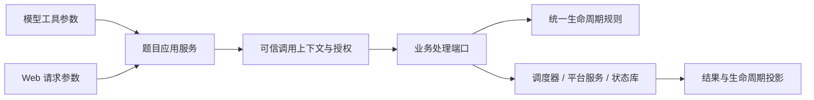

# 题目生命周期与业务入口

本轮为核心架构的第一阶段：保留现有 JSON 数据和 `status` 字段，增加统一生命周期投影及共享业务入口，不进行数据格式迁移。

## 生命周期维度

`challenge-lifecycle.js` 是纯领域规则模块，不依赖宿主、网络或磁盘。题目摘要、详情和命令结果中的 `lifecycle` 均由它计算。

| 维度 | 状态 |
| --- | --- |
| execution | queued / running / stopped / failed / blocked / completed / unknown |
| verification | none / candidate / local / reviewed / platform / rejected |
| submission | not_required / not_started / pending / accepted / already_solved / rejected / unknown / failed |
| environment | 原环境状态，无记录时为 not_allocated |

旧 `status=solved` 仅对应执行维度的 completed，不代表平台已确认，也不自动证明满足记忆沉淀条件。原有统计保留，新增 `lifecycleTotals` 单独统计各维度、待复核数和禁止沉淀的已结束题目数。

`blockers` 给出当前阻塞原因，`permissions` 给出开始、重试、自动提交、排队提交、沉淀和自动释放环境的统一决策。

- 开启自动复核时，每个本地已验证候选需分别通过匹配证据版本的复核。
- 复核、提交仍在执行，或提交仍为 pending/unknown 时，不自动沉淀记忆。
- 平台拒绝本次候选时，不将其作为成功经验自动沉淀。
- 未决提交阻止自动释放环境。人工明确执行环境删除仍由现有授权入口处理。
- 复核重试耗尽后可自动释放环境，但不自动解除记忆沉淀限制。
- 自动提交只使用仍存在且 verified 的候选；在读取平台状态后、发送前再次检查资格。
- 网络错误、超时和提交的 5xx 响应可以留下 unknown，不能直接假定平台未执行并自动重放。

这里的 permissions 是业务决策，不代替调用者权限检查。

## 应用层命令

`challenge-application.js` 维护题目操作目录和统一执行流程：

19 项单题命令覆盖开始、停止、重试、flag 登记、平台提交、提交核对、环境操作、工作台写入、分诊、归档、复核、目标探测、移除 flag、移除题目、本地文件同步、任务列表、任务取消、旧任务核对和 Writeup 导出。任务列表为只读命令；对应工具和 Web 端点调用同一处理端口，不再各保留一份执行分支。

调用上下文由宿主适配层构造，不能从 JSON 参数中指定角色或通道。工具调用按主会话/子代理和所属题目授权；面板按会话工作区授权。子代理可用的命令由目录明确声明。当前宿主绑定不接受任意 system 上下文。

异步授权返回后，宿主在执行处理器前同步复核子代理任务身份；这项检查不能返回 Promise。失效或取消的已知会话返回 `STALE_TASK`，不通过 cwd 回退绕过检查。

后台任务暂保留原调度方式，但开始题目、复核、沉淀、自动提交及资源清理共用领域规则；批量操作、创建题目和全局配置尚未全部迁入命令目录。

## 后续边界

生命周期当前为读时计算的投影，不是已完成的持久化状态机。平台提交现有独立流水和人工核对入口，领域规则检查全部未决记录及尚未完成的本地投影；新增移除保护、`unresolvedSubmissions` 和 `submissionRecoveryPending`。详见 [提交流水与中断恢复](SUBMISSION-RECOVERY.md)。旧可变接口的完整迁移、跨文件事务、其他副作用的操作日志、未决提交自动核对和完整资源租约仍需后续实现。队列与已有平台服务一样，不能宣称具备跨进程 exactly-once 保证。

状态库现已提供内容修订检查和单题事务，flag、候选移除、复核结果与提交流水使用统一草稿编辑后提交。旧可变接口仍保留；单题事务不提供跨文件原子性，实例写者所有权由独立文件锁负责。详见 [状态快照与单题事务](STATE-TRANSACTIONS.md)。

生命周期还会检查未决环境流水与进程内资源占用。`environmentOperationPending` 表示环境仍需核对，新增 `environment_unresolved`、`environment_active`、`resource_in_use` 阻塞原因；相关题目暂不移除或自动沉淀，清理需要排他占用。详见 [资源占用与环境操作恢复](ENVIRONMENT-RESOURCES.md)。

本地文件同步待办使用 `localProjectionPending` 和 `local_projection_pending` 阻止移除与沉淀，也覆盖旧版未登记同步任务的拒绝记录。文件恢复完成后解除阻塞，见 [学习数据保护与本地文件恢复](LEARNING-PERSISTENCE.md)。

`learningUsagePending` 是尚未确认完成的使用统计事件数。它单独阻止移除，不加入成功经验沉淀的 blockers，也不阻止继续解题、提交或环境释放；统计按收口时的结果补记，失败原因显示在题目详情。删除单题和删除会话都遵守这项移除条件。

统一任务登记新增 `unresolvedTasks` 数量和 `taskUncertain`。任何未结束的本地任务阻止移除；取消未确认、租约到期或旧实例遗留的未知任务加入 `task_unresolved`，阻止同来源副本的新消费者、沉淀及环境清理。平台只读核对和任务管理入口仍可调用。详见 [统一任务登记、租约与取消](TASK-LEASES.md)。

本轮不新增 CI、不修改测试、不运行测试套件；只进行语法和静态差异检查。沙箱改造暂缓，没有改变现有执行隔离能力。
