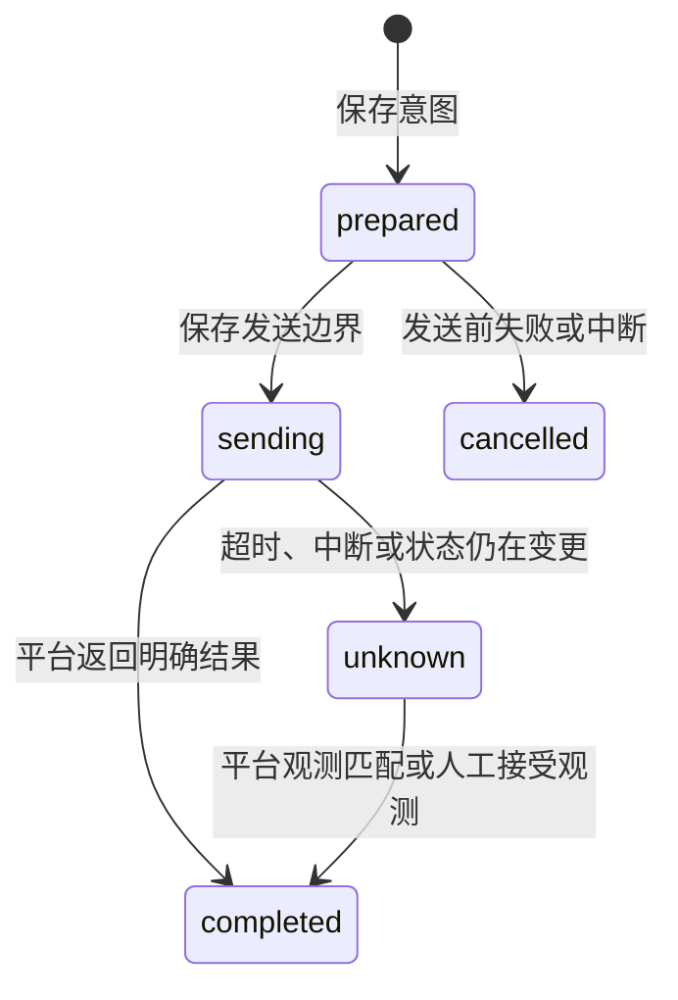

# 资源占用与环境操作恢复

解题并发与靶机串行还会统计未决 solver 任务及尚未释放的本地占用，按 taskId 去重；超时后仅结束编排等待不能让其他题提前取得空出的名额。旧实例未知任务也保留名额，直到结束确认或人工核对。详见 [调度器并发名额](SCHEDULER-TRANSACTIONS.md#并发名额与执行端占用)。

## 本轮范围

`challenge-resources.js` 提供进程内资源准入，`platform-environments.js` 负责环境业务，`environment-journal.js` 负责私有流水。工具、面板、自动清理及配额回收经过同一环境服务，原始平台适配器继续负责协议转换。

资源按完整平台题目来源分组，包含赛事和赛段；非平台题使用本地题目 id。分组不依赖当前 Token 或客户端代次，避免保存配置后绕过正在执行的清理。同一远程题目的不同本地副本会共享占用约束，不同账号的同来源题目也会保守地互相阻塞；稳定账号身份仍待后续实现。

## 使用与删除互斥

| 使用方 | 占用范围 |
| --- | --- |
| solver | 准备派发前取得，宿主任务确认结束后释放 |
| review | 创建复核任务前取得，宿主任务确认结束后释放 |
| submission | 包含排队、发送及本地结果登记，结束后释放 |
| 环境 start / extend | 操作执行期间共享占用 |
| 环境 delete | 排他占用，存在任何使用方时拒绝 |

同一本地题目在旧 solver 或 reviewer 尚未确认结束时，不启动同类的新任务。查询环境状态仍可执行，用于处理未决结果。

自动清理在出队执行时复核同一资源下所有题目的生命周期，并在保存意图后再次检查。删除持有排他占用期间，新消费者无法取得占用；新入队的解题任务等待清理结束再派发。清理不再仅依赖入队前那一次空闲判断。

本地超时或发出 interrupt 不等同于宿主已经停止。宿主句柄增加 `whenSettled()`，等待激活结果完成；本地 Promise 提前返回时，占用继续保留。未收到完成回执时不自动过期释放，可能持续阻止清理和同类新任务。详情中的 `resources` 返回使用数量、清理状态和任务种类。

资源释放现同时等待 whenSettled 与已知 done 的全部观察结束。拒绝、抛错或非 Promise 的结束观察不作为停止证明，而是记录未知任务并继续由持久化任务阻塞准入；缺少这项登记能力时保守保留进程内占用。有效结束观察仍依赖宿主实际契约，不提供服务端 fencing。

## 环境流水

每题最多保留 100 条 `environmentJournal`，包含 UUID、动作、来源和凭据配置摘要、阶段、时间、结果及核对证据。凭据摘要不在详情中返回，原始 Token 不进入流水。未决记录不会因达到容量而被淘汰。

环境写操作先保存 prepared，再保存 sending，关键保存使用现有 fsync 机制。保存失败时不调用远程写接口。收到结果后，流水、环境投影和事件通过同一次事务保存。

插件恢复时，将无活动请求的 prepared 记为未发送，将 sending 转为 unknown；不重放创建、续期或删除。未决环境操作阻止同一来源题目的新消费者、后续环境写操作、自动清理、题目移除和成功经验沉淀。

明确的配额拒绝可触发原有配额回收，再尝试创建一次；网络错误和未决结果不走这条重试。自动删除收到明确失败后至少间隔一分钟再试，避免每个看门狗周期重复请求。

## 查询和人工收口

面板「核对环境」或 `ctf_platform_env({id, action:"status"})` 只读取平台环境状态：

- 明确存在的稳定环境可收口未决 start；明确不存在可收口未决 delete。
- starting、creating、deleting 等过渡状态不视为稳定观测，继续等待核对。
- 未决 extend 不能仅凭环境存在证明续期成功，不自动收口。
- 主会话可显式设置 `acceptObservedState:true`，或在面板勾选「以平台当前状态收口待核对操作」。只有观测为稳定存在或不存在时才收口，并保存 acknowledged；这不证明先前操作执行成功，也不重发操作。
- 子代理不能使用该人工收口参数。更换凭据后不能用新配置的观测收口旧配置的记录，需恢复原配置。
- 查询只修改获授权的本地题目，其他工作区的同来源副本仍需分别处理；返回计数包含这些副本的未决记录。

删除成功回显按平台接口的成功语义记账；若平台明确回显 deleting 等过渡状态，保留未决。没有平台状态证据时不从一般 HTTP 404 或空查询响应推断环境不存在。

环境核对完成后，会尝试恢复此前因环境阻塞而未登记过提交记录的自动提交；已有同候选提交流水的不自动重提。

## 复核身份修复

上一轮的 solver 尝试检查要求编号及 runId 匹配，误拦了编号为 0 的复核任务。本轮为复核引入独立 jobId，结合活动任务和候选证据指纹验证激活、会话绑定与结果。复核意图保存失败不派发，卸载后的复核结果不再写回旧实例。

## 剩余边界

- 资源准入现已关联持久化任务身份、协调端心跳和统一取消请求；重启后未知任务继续阻塞。仍没有远端 fencing token 或自动确认旧子代理停止的能力，见 [统一任务登记、租约与取消](TASK-LEASES.md)。
- 对平台返回的任务完成、环境成功及状态字段仍依赖适配器契约；不提供服务端幂等或 exactly-once 保证。
- 配置摘要不是稳定账号 ID；更换同账号 Token 后的恢复连续性仍未解决。
- 状态库新增进程内 changeVersion，用于失效环境阻塞索引，避免在每个生命周期查询中全量扫描题板。它不是持久化实体修订号；旧代码若直接改对象又不保存，仍会绕过此索引。
- 没有改变解题执行隔离，沙箱仍暂缓。本轮未新增或运行测试，未修改 CI，仅进行语法及差异检查。
