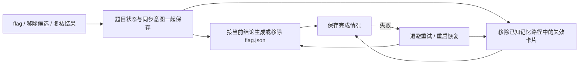

# 学习数据保护与本地文件恢复

## 学习数据仓库

`json-repository.js` 提供同步 JSON 文件读写，`learning-store.js` 管理 `memory.json`、`knowledge-usage.json` 和旧记忆路径迁移。宿主不再自行吞掉读取异常后构造空库，也不忽略写入失败。

- 只有 `lstat` 明确返回 ENOENT 时才使用空数据。权限、I/O、JSON 损坏、结构错误、不支持的版本、非普通文件均返回错误并保留原文件。
- 记忆库支持旧版及 v2 卡片的既有规范化；无法识别的卡片、未来版本和不合法的使用统计阻止保存，不通过过滤记录把坏文件“清空”。保留库和卡片中的额外字段。
- 更新在独立草稿上同步执行。保存前比较原文件内容摘要，写入随机独占临时文件、fsync，再安装到目标位置。新建使用同目录硬链接，避免覆盖在检查后新出现的文件；已有文件使用 rename。非 Windows 平台同步父目录。
- 没有数据变化且没有先前写入错误时不写文件。若上次安装文件后同步失败，即使重放看到相同数据，也重新保存及同步，不能仅因回执已可见就消除持久化错误。临时文件仅清理本次操作创建的名称，不删除原文件。
- 读取与写入错误分别保留，读取成功不会直接消除先前的写入错误。若文件已安装但后续同步失败，错误带 applied 标记，不宣称操作从未发生。
- 旧路径迁移先校验源文件，再以“不覆盖已有目标”的方式保存。迁移失败不标记完成，也不跳过故障源去猜测另一份空数据。

沉淀打法卡、更新记忆使用次数和更新知识使用次数都经过仓库。显式调用在失败时返回错误；批量沉淀返回成功数量及逐题错误，不再将全部失败报为成功。后台召回允许降级继续解题，但显式召回返回 warnings，题板也展示存储异常，不将故障解释为“没有匹配”。

`state.get.storage` 返回当前记忆库和知识使用统计的读取/写入状态。初始状态未主动读取，不代表文件健康；在实际访问后更新诊断。内容摘要只是进程内与外部改动的尽力检查，不替代跨进程文件锁，两个并发写者仍可能落入最后一次检查与 rename 之间的窗口。

## 持久化本地同步待办

`challenge-projections.js` 处理 `flag.json` 和失效记忆清理。题目中的 `localProjection` 保存任务 id、待同步阶段、记忆路径、尝试次数、错误及重试时间。

登记 flag、移除候选及复核拒绝都在状态事务中登记待办。关键事务保存成功后再操作派生文件，不因 flag 文件写入失败将已保存的结论改成请求失败。

恢复每次从当前题目状态选择 flag，优先保留平台确认的证明，再选择其他已验证结论；没有已验证结论时移除派生 flag 文件。不会使用旧待办里缓存的候选覆盖后来得到的平台证明。新一轮状态修改会生成新的任务 id，同时保留尚未完成的记忆失效意图。

复核拒绝、移除已验证候选会清理当前及已知旧记忆路径中对应题目的卡片。文件缺失且没有需要迁移的数据时视为已清理，不创建空的旧库；损坏或未来版本的库不覆盖，任务继续等待修复。更换记忆目录时，未完成的任务也会纳入当前路径。

每次恢复独立尝试 flag 和记忆步骤；某个步骤失败不妨碍另一个完成。进度再以状态事务保存。失败按退避重试，最长间隔五分钟；每次看门狗最多处理五道题。旧版已有 rejected 复核但没有同步任务的题目，会逐批补登记待办。

待办期间，生命周期返回 `localProjectionPending` 和 `local_projection_pending`，阻止题目移除及成功经验沉淀；相关记忆不参与列表和召回。题目结论本身仍是提交依据，不因为一个派生文件故障而撤销真实平台回显。工具结果使用 `projectionPending` 与 warning 明确说明文件尚未同步。

flag 文件尚未同步时也阻止新尝试派发，避免新子代理读到旧的已验证声明。flag 已同步、仅剩记忆清理时可以继续解题，故障记忆仍不参与召回。

修复文件格式或权限后，可点击「重试本地同步」，或调用主会话工具 `ctf_challenge_sync({id})`，立即重试文件和使用统计待办。两类待办均没有时，该工具会登记一次新的文件同步意图，修复派生 flag 文件；只有统计待办时不额外登记 flag 文件任务。不重新提交 flag，不重新运行复核。子代理不能调用这个管理入口。

## 使用统计恢复

宿主创建新尝试时保存 `usageTrackingVersion=1` 和召回时的 `memoryFile`。正常收口、进程中断恢复、插件卸载及遗留会话清理都会在同一状态事务中登记 `attempt.usageEffect`，包含固定的成功结果、事件时间、记忆/知识引用及各自进度。没有有效召回引用时不生成空待办。收口保存使用 fsync；保存失败后，状态库后续普通重试也保留同步要求，`persistenceStatus().durablePending` 表示仍待完成的同步要求。

`learning-usage.js` 在收口后立即尝试应用，看门狗与重启恢复继续处理。只有状态库没有 dirty 标记时才写目标文件。每题先处理编号最小的未完成事件，当前事件退避时不越过它处理后续事件；记忆和知识分别尝试、分别确认，失败退避最长五分钟。每轮后台最多处理五道题各一个事件，手动重试每次最多处理五个连续事件。

每道题的统计流使用首次事件的运行 UUID 作为 `learningUsageStreamId`，尝试编号作为递增序号。目标 JSON 中的 `usageReceipts[streamId]` 与本次计数在同一个文件替换中保存，然后才在状态库确认该阶段。若目标文件保存后、状态确认前崩溃，重放会读取去重进度而不再次累加。去重进度按题目流增长，不按尝试数增长；不自动删除，避免旧状态待办重放时失去依据。

同一事件中的重复引用只计算一次。记忆计数更新匹配的现存卡片；已被失效清理移除的卡片不重建，但仍保存回执，避免将来同 id 卡片重建后重放旧次数。知识计数按引用 id 记录。`lastUsedAt` 使用原事件时间且不倒退。成功次数保留既有语义：以尝试收口时的解题结论为准，不因之后的平台核对或复核结果自动追溯调整。

记忆事件固定写回召回时的路径，不在重试时猜测当前目录。原库缺失、损坏、权限故障均保留待办和错误，不新建空记忆库，也不把计数写入另一份库。记忆迁移保留原有计数及回执，但已复制出去的库不会持续跟随旧文件之后的更新；应先完成统计待办，再迁移或删除旧目录。

`state.get.learningUsagePending` 返回可见范围的待办总数，生命周期中同名字段返回单题数量；详情保留逐目标错误。待办未确认时阻止移除单题或所属会话，避免丢失恢复来源。继续解题、提交、环境清理和沉淀不受统计故障阻塞。只有统计待办的题目也显示手动重试按钮。

旧版尝试没有追溯生成统计待办，因为无法知道旧回调是否已计数，盲目补记会造成重复。独立使用编排器且未配置新持久化入口时，保留原有 `onMemoriesUsed` / `onKnowledgeUsed` 回调兼容行为；宿主已改用持久化入口。

## 当前限制

这是“先保存意图，再幂等同步文件”，不是跨文件原子事务。在恢复完成前，各文件可能短暂不一致，因此相关操作需要遵守生命周期阻塞。

统计待办与去重进度依赖同一进程按题目顺序处理，不提供跨进程排他或跨文件事务。人工删除、修改或独立回滚计数文件与去重进度会破坏去重前提；全量备份恢复应同时包含状态库、记忆库和知识使用统计。不同路径的文件副本不构成实时复制。

同步仅覆盖当前及已知旧路径；任意新增外部资料和未来重新导入的记忆尚无全局撤销索引。任务完成后对派生文件的手工改动也不会被持续扫描，可用手动同步入口重新生成。

状态库、知识索引和仓库仍使用同步 I/O。此轮解决数据保留及错误反馈，没有宣称已解决大规模题板性能、跨进程并发或故障设备上的断电一致性。Windows 不同步目录，首次创建还要求文件系统支持同目录硬链接。

按当前范围未新增或运行测试，未修改 CI，只做语法和差异检查；沙箱继续暂缓。
