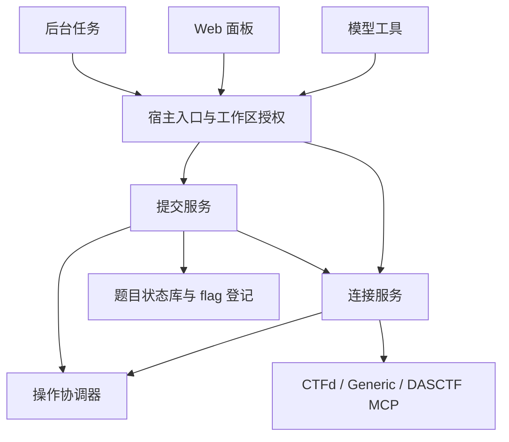

# 平台核心架构

平台入口继续使用现有 `ctf_*` 工具和 Web 端点。宿主装配、工作区授权、题目文件落盘留在 `index.js`，平台连接与提交生命周期拆分为独立服务。

## 模块职责

| 模块 | 职责 |
| --- | --- |
| `platform-service.js` | 校验与保存配置、适配器注册、能力声明、客户端缓存、来源绑定、环境操作调度 |
| `platform-operations.js` | 按资源串行执行、合并并发读取、合并相邻相同写操作、限制待处理任务数量 |
| `platform-submissions.js` | 手动和自动提交、提交编号与状态、平台回显登记、已解缓存、关闭时的状态保护 |
| `platform-identity.js` | 不含凭据的平台来源和题目来源标识 |
| 各适配器 | 平台协议、数据字段与错误响应转换 |

新增平台优先在连接服务的适配器注册表中增加构造函数和能力声明。业务层不应根据某个方法是否存在猜测平台能力；不支持的操作返回明确错误。

## 连接生命周期

当前仍保存一套活动连接，不新增多连接配置格式。原有 `platform.json`、工具参数及面板端点继续使用。

客户端缓存按完整配置及有效凭据生成的内部摘要区分，最多保留 8 项；摘要与原始凭据均不作为用户侧连接标识返回。保存配置后清理缓存并增加连接代次，避免换账号后继续使用旧账号的已解缓存。DASCTF 环境变量 Token 在使用时读取，不因自动探测而复制到配置文件。

题目操作检查已保存的平台来源。Generic 题目还检查导入时的 profile，避免更改同一站点的接口映射后，将旧题发送到另一套接口。来源不匹配时要求恢复对应配置。

DASCTF 客户端保留 MCP 初始化状态，支持没有会话 ID 的已初始化连接。带会话的请求遇到 HTTP 404/410 时使会话失效；明确列入只读范围的请求可重新初始化并重发一次，写操作返回 `MCP_SESSION_EXPIRED`，不自动重放。诊断日志最多保留 100 条。

## 并发与操作顺序

协调器的上限为 128 个运行中及排队中的资源任务，不代表每个平台允许 128 个并发请求。不同资源仍可并行，各适配器继续负责协议相关的限速。

- 并发相同的账号、题目列表、题目详情和提示读取共享正在执行的请求，不长期缓存读取结果。
- 同一连接与工作区的导入串行执行，使去重检查与创建流程不会因同时点击或后台拉题而并行重复。
- 跑板将已选候选和连接快照传递给导入阶段，避免二次拉取题板，也避免中途切换配置导致列表与详情来自不同连接。
- 同一远程题目的提交按有效凭据和题目来源串行；只有相邻且相同的本地提交请求合并。
- 环境操作按远程题目串行。`start → delete → start` 保留完整顺序，最后一次 start 不会错误共享第一次 start 的结果。
- 插件关闭后拒绝新任务及尚未开始的排队任务。已经发送的远程请求可能仍完成；旧提交服务不再将完成结果写回已卸载实例的状态库。

## 提交状态

每次执行提交生成 `submissionId`，先保存 `prepared`，真正交给适配器前保存 `sending`，兼容投影仍显示 `pending`。关键记录无法保存时返回 `STATE_NOT_DURABLE`，不发送远程提交。平台结果先保存到每题流水，再更新 flag 和本地文件；中断恢复与核对规则见 [提交流水与中断恢复](SUBMISSION-RECOVERY.md)。

平台 `correct` 回显才登记平台验证；`already_solved` 表示题目已解，不确认本次 flag。手动与自动提交共用这套逻辑，记录最终状态、错误码、消息及时间；两者的排队和执行期间都会阻止后台提前释放对应靶机。自动提交仍遵守复核开关；排队期间关闭自动提交或进入待复核状态时，会在执行前暂停。

已解缓存最多 1000 项，有效期 5 分钟，按连接代次、有效凭据和完整题目来源隔离。不同账号、赛事及赛段不会共享已解状态。

CTFd 只对 GET/HEAD 执行通用重试。提交或付费提示解锁发生网络错误时，不能据此断定平台没有执行，调用者应查询平台状态后决定是否再次操作。

## 当前边界

环境业务已迁入 `platform-environments.js`，使用独立流水、进程内资源占用及人工核对入口。solver、review 和 submission 也参与占用，防止清理与消费者并行；详见 [资源占用与环境操作恢复](ENVIRONMENT-RESOURCES.md)。原平台服务的 environment 方法属于底层协议协调入口，宿主业务经过新的环境服务。

协调和请求合并仅在当前插件实例内有效，不替代服务端幂等键或跨进程锁。排队请求不会随重启自动重放；已保存的发送阶段会恢复为未决记录，明确回显尚未完成的本地投影可在重启后恢复。核对当前由人工触发，远程请求超时后的具体 flag 结果仍可能不确定。多连接持久化、跨进程事务和统一流式响应传输层留待后续演进。

本轮未新增 CI、未修改测试，也未运行测试套件；仅进行语法与静态差异检查。此前 227 项通过的测试结果不代表本次架构调整已经过回归验证。
