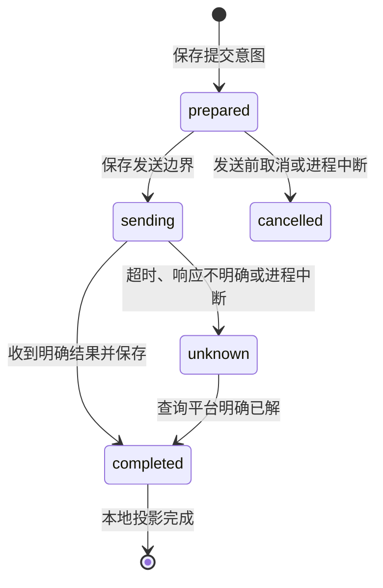

# 提交流水与中断恢复

## 已处理的问题

以前只保存 `platformSubmit` 最后一次结果。一次提交超时后，后续的配置错误或新提交会覆盖这条记录；平台已经回显 correct 时，本地 flag 文件写入异常也可能将结果改记为请求失败。请求重放、成功经验沉淀和环境清理因而缺少可靠依据。

现在由 `submission-journal.js` 保存每题的 `submissionJournal`，`platform-submissions.js` 决定发送、恢复和核对。原 `platformSubmit` 继续作为最后一次提交的兼容投影。

## 发送边界

每次提交包含 UUID、来源与凭据配置摘要、候选 flag、创建/发送/更新时间、原始归一化结果、本地投影进度。核对结果单独保存在 `resolution`，保留原先的不确定结果。凭据摘要只保存在私有状态文件，不在题目详情中返回；不保存原始 Token。

- `prepared` 保存成功后可以读取平台详情；请求真正交给适配器前必须保存 `sending`。
- 提交流水和兼容投影通过同一次状态更新落盘。关键写入对临时文件执行 `fsync` 后 rename；非 Windows 平台还同步父目录。关键保存失败时不发出提交。
- `sending` 表示请求可能已经发出，不保证平台已收到。进程恢复时转为 `unknown`，不会自动重放。
- 明确回显先落盘，再登记 flag 和本地文件。`applied=false` 表示本地投影待恢复；恢复只重复本地操作，采用退避重试，不再调用平台提交。
- 配置、权限或队列错误发生在执行前时，只返回错误，不覆盖已有提交证据。
- 每题最多保留 100 条流水；优先淘汰已经完成本地投影的旧记录。未决记录和未完成本地投影的记录不会因容量限制被淘汰；这些记录达到上限时拒绝新提交。

普通事实、输出和事件仍使用原有保存方式。当前不是独立的追加日志数据库，也不承诺整机断电、故障存储设备或多进程同时写入时的数据完整性。Windows 未同步父目录。

## 核对与人工重提

主会话工具 `ctf_platform_reconcile({id})` 与面板「核对平台结果」共用 `platform.submission.reconcile` 命令和工作区授权。

核对只调用题目详情读取，不提交 flag。只有平台明确返回 `solvedByMe=true` 才将本题当前凭据配置范围内的未决记录收口为 `already_solved`。它证明题目已解，不能证明某条未决请求中的 flag 正确，因此不会赋予候选 `method=platform, verified=true`。

平台返回未解、缺少解题字段或查询失败，都无法证明旧请求未执行，记录继续保持未决。切换凭据后不能用新凭据的解题状态收口旧凭据的流水；需恢复原配置。旧版本记录没有凭据摘要，会标记 `legacy`，人工核对时使用题目来源匹配的当前连接。

若仍需重复提交，主会话显式设置 `ctf_platform_submit({id, flag, retryUnknown:true})`；面板需勾选「允许重复提交」。新流水保存 `retryOf`，旧未决记录继续保留，不因本次拒绝或成功而被覆盖。人工重提不会自动解除旧记录造成的生命周期阻塞，仍需核对。同一状态库内、相同远程题目与凭据范围的副本也参与未决检查；核对操作仅修改获授权的本地题目，不修改其他工作区的副本。

## 生命周期联动

生命周期检查所有保留的未决流水，而不只看最后一次提交；新增 `unresolvedSubmissions` 和 `submissionRecoveryPending`。未决提交或本地投影尚未恢复时，暂停自动提交、记忆沉淀、自动释放环境及题目移除。移除会话题目也先检查全部题目，避免绕过保留规则。删除状态保存失败时保留题目文件。

面板详情展示最近 10 条提交流水及本地恢复错误。新入口仍只允许主会话或有权操作该题的面板上下文；子代理不能核对或重复提交其他题目。

## 剩余架构工作

1. 状态库现已增加只读快照、内容修订检查及单题事务，flag、复核、提交流水及调度器尝试生命周期已迁入；宿主其他模块的旧路径仍需继续迁移。接口与限制见 [状态快照与单题事务](STATE-TRANSACTIONS.md)。
2. 提交、solver、review 和环境操作现已接入持久化任务身份、心跳和统一取消请求；远端停止确认、跨独立状态目录的协调与服务端 fencing token 尚未完成。见 [统一任务登记、租约与取消](TASK-LEASES.md)。未结束任务的资源保护也适用于显式重复提交，不能仅靠 `retryUnknown=true` 绕过。
3. 当前核对是人工触发的正向查询，没有提交回执查询接口、后台核对调度或跨进程租约；不具备 exactly-once 保证。凭据更换后的账号连续性仍需稳定账号 ID 支持。
4. 大量题目时，整个 JSON 状态库反复序列化仍会阻塞事件循环；后续可引入带事务的存储实现和独立读模型。

遵照当前范围，本轮未新增或运行测试、未改 CI。仅检查 JavaScript 语法及差异格式。沙箱改造继续暂缓。
