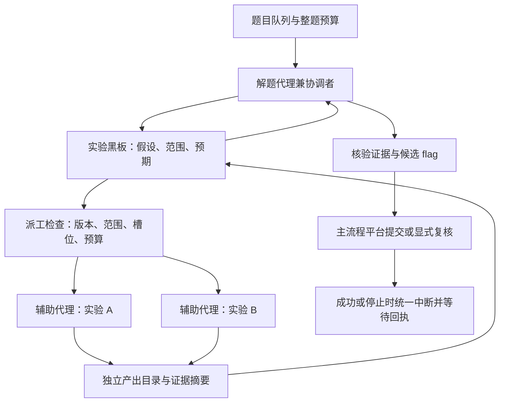

# 按实验假设派工的蜂群

这一轮继续参考 [FishCodeTech/muteki](https://github.com/FishCodeTech/muteki)，阅读版本为 `c60c8feeff69a64aa5abfbda113f3f33bff30af4`。重点是 [按意图派工](https://github.com/FishCodeTech/muteki/blob/c60c8feeff69a64aa5abfbda113f3f33bff30af4/muteki/swarm/coordinator_schedule_dispatch.py)、[协调循环](https://github.com/FishCodeTech/muteki/blob/c60c8feeff69a64aa5abfbda113f3f33bff30af4/muteki/swarm/coordinator_scheduler.py)、[阶段预算](https://github.com/FishCodeTech/muteki/blob/c60c8feeff69a64aa5abfbda113f3f33bff30af4/muteki/swarm/stage_policy.py)与资源归属的设计思路。本实现独立编写，没有引入 Muteki 的代码、提示词、依赖或运行服务。

## 当前实现

每道题已有的解题子代理兼任协调者，先侦察和登记假设，在存在可独立验证的实验时派出辅助代理。简单题继续由协调者直接完成，不自动为每题创建固定数量的代理，也不增加一个专门调用模型的规划循环。



适合的分工包括：不同附件的静态分析、不同编码假设的独立验证、对某个解码结果进行独立复算。依赖相同可变服务状态、需要同时修改同一脚本、尚无明确假设的任务，应先由协调者收敛问题。

## 开启与操作

重新加载插件，在面板「设置 → 编排」开启「按假设派工的蜂群」。也可以在插件配置中设置：

```yaml
swarmEnabled: true
swarmConcurrency: 2
swarmWorkerTimeoutMs: 180000
```

- 默认关闭；开启会增加辅助代理的模型用量。
- `concurrency` 控制同时运行的题目数，每题保留一个协调者。
- `swarmConcurrency` 控制所有题目合计的辅助代理槽位，范围 1–4，默认 2。与题目并发数分开计算。
- 每题同时最多两个辅助代理；每次尝试累计最多四次派工。已派过的同一个实验 key/epoch 不会在同一次尝试重复派发，超时也不绕过记录自动补发。
- `swarmWorkerTimeoutMs` 范围 30–600 秒，默认 180 秒；实际取它与父尝试剩余时间的较小值。辅助计时使用单调时钟，系统日期跳变不会延长运行时间。
- `offline` 允许同时分析不同的离线材料；同一题最多一个 `target` 辅助代理操作靶机。协调者须遵守提示，在 target 代理退出前不并行操作该靶机。

先登记一个实验：

```json
{
  "id": "题目 id",
  "key": "misc:metadata-marker",
  "hypothesis": "附件元数据中可能存在可解码标记",
  "scope": "仅检查当前图片附件的文本元数据",
  "expectedResult": "提取到能够独立解码的完整标记"
}
```

以上参数传给 `ctf_experiment_record`。用返回的版本与 epoch 调用 `ctf_swarm_dispatch`：

```json
{
  "id": "题目 id",
  "key": "misc:metadata-marker",
  "expectedVersion": 1,
  "epoch": "实验工具返回的 epoch",
  "lane": "offline"
}
```

`ctf_swarm_status({"id":"题目 id"})` 返回本题派工历史、执行摘要、工作目录以及全局占用数量。辅助代理退出时协调者会收到提示，随后应读取黑板和原始证据。工具不会以输出中的“成功”或候选 flag 自动改变实验结论。

`ctf_swarm_cancel({"id":"题目 id","workerId":"辅助代理 id"})` 单独停止一个代理。面板题目详情中的「蜂群派工」提供相同操作，并可以直接从尚未派发的实验选择「离线分析」或「当前靶机」。工具派工只允许主会话或当前已绑定的协调者；辅助代理无此权限。

## 证据与权限

辅助代理使用专用 `ctf-auto-helper` preset，保留执行和文件工具，移除原生 delegation 与 ask-user 入口，提示词只包含本题和分配的实验。该 preset 在首次派工时注册，失败会返回执行错误，不回退为具有完整编排入口的默认角色。

每个辅助代理使用 `artifacts/swarm/<runId>/<workerId>/` 作为工作和产出目录，读取题目根目录的 `statement.md`、附件、notes 与实时实验黑板。通过插件工具，它只能：

- 读取本题数据和知识；
- 向自己的产出目录写文件，引用该目录中的证据；
- 更新已分配实验的命令、实际结果、下一步和证据，不能改换假设、范围、预期或重开其他方向；
- 登记 `verified=false` 的候选 flag，由主流程统一核验。

插件拒绝辅助代理的环境变更、平台提交、递归派工和共享 notes 写入。会话身份绑定前也拒绝它通过产出目录抢先调用插件工具。实验定义、材料/靶机 epoch 或父尝试变化后，旧代理的写入权限立即失效，下次维护会请求中断。

这些是插件工具的权限检查和协作约定。辅助代理与协调者仍在同一宿主运行，工作目录不构成操作系统文件或网络沙箱；原生 shell、文件和 Web 工具的权限由 DSH 宿主控制。协调者不应通过原生 subagent/workflow 额外派工，否则这些手工代理不在本模块的限额与生命周期内。

`completed` 只说明执行端正常退出，`supported/refuted` 仍需由实验工具记录具体结果和文件证据；二者均不等于 flag 被平台接受。证据 SHA-256 只核对文件字节，不能证明结论正确。

## 前置依赖与就绪后续派

创建或更新实验时，可以设置至多四个前置条件：

```json
{
  "dependsOn": [
    { "key": "misc:decode-header", "status": "supported" },
    { "key": "misc:wrong-format", "status": "refuted", "version": 3 }
  ]
}
```

引用须位于同一材料/靶机 epoch，且先登记被引用的实验。拒绝重复、自引用、成环和超过 16 项的前置链。`version` 可选：指定时必须严格匹配；不指定时，待派任务可以等待之后产生的有效结论。

`ctf_swarm_dispatch` 会核对整条前置链的所需结论、争议状态及证据 SHA-256。条件不足返回等待原因。`ctf_swarm_queue` 接受与 dispatch 相同的参数，将一个明确规划的实验登记为待派任务；同一次运行尝试内，维护循环会在前置证据和槽位就绪后自动派工。每次尝试最多登记四个待派任务，实际派工仍受原有累计与并发上限约束。

派工和登记结论时，保存当时使用的前置版本与文件摘要；运行中再次写入结果前检查这些快照。即使依赖没有指定固定 version，已经产出的结论也不能自动改为依赖后来产生的新版本。上游变化后，须先补新证据复验依赖结论，下游才能继续。

面板显示等待原因，并提供「就绪后派：离线/靶机」和「取消待派」。工具取消待派任务使用 `ctf_swarm_cancel` 的 `queueId`；任务已经派发时会返回实际 `workerId`，必须针对执行端停止，不能把取消队列当成远端已停止。

排队只在当前尝试有效。规划版本或材料变化时失效；父尝试停止、收尾、关闭蜂群时取消；重启后只展示记录，不自动恢复旧意图。想在新尝试继续，需要协调者重新读取证据后显式登记。普通面板读取只检查元数据，文件字节由派工和结论写入检查，不能把面板显示的元数据就绪当作实时文件核验。

## 证据冲突与独立复验

矛盾需显式登记，不以模型多数票或自然语言相似度自动裁决。使用 `ctf_experiment_review_open`，提交原实验的 `key`、`expectedVersion`、`epoch`，以及至少 12 字符的具体争议 `reason` 和新证据 `evidencePaths`。

宿主在一个持久化事务中完成两件事：原结论增加未决争议并冻结；创建带 `reviewOf` 关联的复验实验。争议文件须有不同于原实验历史证据的新字节；原始证据文件仍需可核对。一个结论同时最多一个未决争议，累计最多四次复验，不覆盖旧记录。

协调者将返回的 `review.key` 派给蜂群。它使用独立的 verifier 任务身份、会话和产出目录，须复现同一假设，并分别检查原证据与争议证据。`supported/refuted` 仍表示对原假设的判断，不表示对协调者的投票。原协调解题子代理不能自行填写独立复验的结果；主会话也可以在独立复现后手工登记。

复验结论不会自动覆盖原记录。协调者读取原始输出后，通过 `ctf_experiment_review_resolve` 提交原 `key`、`reviewKey`、`epoch`、两边的当前版本 `expectedVersion/expectedReviewVersion` 和采纳依据 `reason`。采纳检查：

- 复验已记录 supported/refuted 实测结论；blocked 或执行端 completed 不足以收口。
- 原证据、争议证据和复验输出均能核对文件字节；复验必须提供不同于两方旧文件的新输出，复制或改名不算新复现。
- 原结论的范围和内容仍与复验发起时一致，复验引用的前置条件及版本仍有效。

通过后，在一个事务中更正原实验的结论、结果、证据和前置快照，记录 upheld/overturned，关闭争议并保留历史。原证据或争议文件被删除/修改时无法直接采纳，须先恢复可核对的文件；建议始终使用新的版本文件名保存产出。复验助手不能采纳自己的结果；这条路径不修改 flags 或比赛得分，flag 继续走原有平台验证或显式复核。

## 统一停止与恢复

派工记录先持久化，再触发外部执行。保存失败时不启动辅助代理；修复存储后会收口为派工前失败，重复请求不会意外补启动一个未知代理。

辅助会话与协调者登记在同一 solver 任务中，共用题目资源租约。用户停止、父尝试结束、超时、已验证 flag、关闭蜂群或卸载插件都会中断相关辅助代理。进入预算收尾后不再接受新派工，现有代理接收收尾提醒。

停止请求与退出回执是两个阶段。`stopping` 继续计入槽位，并保留题目资源；只有观察到执行端完成后才释放。回执缺失或被拒绝时标记 `unknown`，通过任务流水保持资源阻塞；不能用超时猜测远端已经退出。

重启后展示持久化派工历史，并根据统一任务的未决状态显示 `unknown` 或 `interrupted`，不自动重派历史代理。需要时在任务流水核对会话、请求中断并明确收口，完整 sessionIds 包括协调者和辅助代理。

派工输出摘要、prompt/output 字符数与费用粗估计入题板汇总；估算仍基于文本字符数，不能代替模型账单。Writeup 包包含 `swarm.json`、实验记录和限额内的产出文件。

## 验证范围与后续方向

自动化覆盖了工具与面板调用、并发与靶机实验串行、重复派工、证据权限、迟到输出、停止回执、写盘失败、单调预算和重启后的未决占用。当前还需在真实 DSH 宿主验证 helper preset 注册、消息通知和模型用量；尚无真实比赛数据证明解题率提升。

后续可继续做能力与成本路由：等宿主提供可靠用量后，为静态分析、脚本复算和复杂推理选择不同模型，并按真实成本限制扩容。当前版本保持现有模型路由，不用字符估算冒充实际账单预算。
