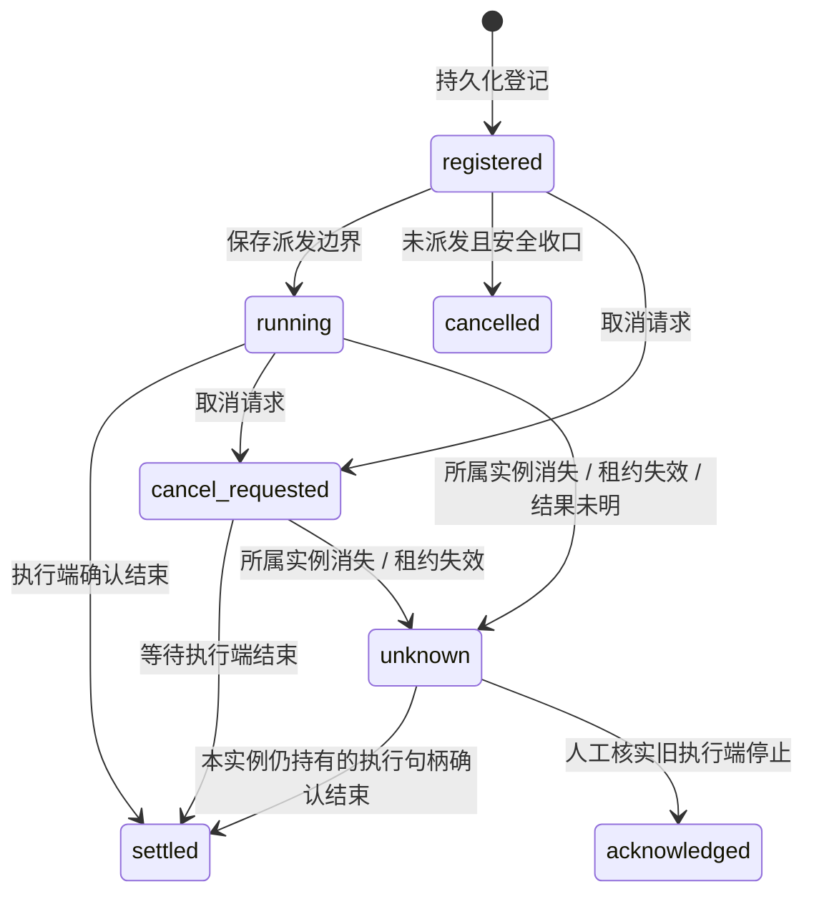

# 统一任务登记、租约与取消

## 登记边界

`task-registry.js` 管理解题、独立复核、平台提交、环境写操作四类任务。`challenge-resources.js` 取得资源占用时，先在同一个 `state.json` 中持久化任务，保存成功后才把占用交给调用方。每次插件加载生成新的实例 `ownerId`，每个任务生成独立 `taskId`。

每题的 `taskJournal` 保存任务类型、资源键、共享/排他模式、所属实例、阶段、心跳、租约截止时间、取消请求、关联尝试或操作流水、执行端会话及核对说明。公共详情和工具输出移除所属实例标识与内部资源键，任务 id 仅用于定位，不作为授权凭据。

状态格式现为 v4，继续读取旧版 v1/v2/v3 数据，在下一次成功保存时写为 v4。旧程序会拒绝高版本状态，避免降级后忽略任务租约或创建输入准备待办而重新派发；不要手动改回版本号绕过这项保护。回退程序时需先停止执行端，并使用匹配版本的完整备份。

solver 准备阶段、review 创建阶段、submission 排队阶段取得占用；环境写操作仍在串行队列出队时取得占用。尚未出队的环境请求没有独立任务登记，重启也不重放这段内存队列。环境状态查询、提交核对及其他只读请求不占用写任务租约。

任务登记和派发不是跨记录原子提交：创建尝试/业务流水后，调用方先持久化 `running` 及关联编号，再调用子代理或平台写接口。两次保存之间退出，恢复仍有足够依据判断是否越过派发边界；任何关键保存失败都不继续派发。

## 阶段

`settled` 表示所跟踪的执行端已经结束，不等于解题成功或平台接受。平台结果仍由提交/环境流水解释。`cancelled` 表示未越过已保存的派发边界；不把已发送的操作伪报为撤销成功。

## 心跳与恢复

默认租约为 60 秒，至少间隔 15 秒更新一次协调端心跳。看门狗每 5 秒检查任务，按题目轮转，每轮最多选择 20 道题的恢复或心跳，并合入最多 20 条待保存的完成结果。同题计划在一个草稿内处理，多题共享一次维护保存；启动恢复按最多 128 题分块，再允许调度恢复。写盘失败时暂缓推进。详见 [批量事务与任务维护保存](BATCH-PERSISTENCE.md)。

心跳表示当前插件实例仍在维护任务，不是远端进程的存活证明。本实例的截止时间和心跳间隔使用 `performance.now()` 单调时钟，系统日期校准不再决定本地租约是否有效。持久化的 createdAt、heartbeatAt、expiresAt 仍为墙上时间，供审计和旧记录查看；不用于恢复旧实例的执行权限。生命周期在有运行时协调端时采用它的判断，无协调端的独立投影才保守地参考记录时间。

租约一旦被观察为过期，本实例不再恢复它；转为 `unknown` 并请求取消，阻止新派发和结果发布。心跳写盘成功后还要核对旧租约是否已过期，慢 fsync 不能让旧任务续命；保存派发边界之后也再次检查，再决定是否调用执行端。运行时续租进度在整批保存成功后才更新，失败时不提前延长。详情为本实例任务显示单调时钟计算的 `remainingMs`，旧实例任务仍显示记录截止时间。

若单调时钟本身无效或回退，实例保持暂停并尝试取消已知任务，不能靠下一次读数恢复；`taskStorage.clockError` 提供诊断。工厂可注入独立 `monotonicNow`，与墙上时间 `now` 分开。不同平台对整机休眠的单调计时语义可能不同，本地时钟始终不能代替服务端期限和停止证明。解题的单次及整题运行预算已接入独立单调计时与检查点，恢复停机时长仍参考日期；其他后台退避、缓存等时间未全面迁移。见 [解题预算与单调计时](BUDGET-TIMING.md)。

新实例看到旧实例的 `registered` 且没有 `startedAt`，可按未派发收口；看到已经派发的任务则保留为 `unknown`。没有句柄的旧任务不自动重跑，不因过期删除。未决任务会阻止同一平台题目的所有本地副本继续使用资源、清理环境、移除和沉淀。

未决 solver 任务还保留全局解题并发名额，`unknown`、取消和租约过期均不释放名额；本地编排等待结束也不等于占用结束。登记服务提供按状态修订缓存的脱离原数据的占用视图，资源服务按 taskId 合并本地占用，调度器据此限制新派发及靶机串行。旧实例的任务同样计入，面板「调度」展示「待确认结束」及真实占用。规则与边界见 [调度器事务与尝试身份](SCHEDULER-TRANSACTIONS.md#并发名额与执行端占用)。

旧版缺少 taskId 的 running 尝试、pending 复核、sending/unknown 平台流水，以及旧版未决提交投影，会补登记待核对任务并关联 taskId。不追溯所有历史已结束记录：旧版已收口但远端尚未确认的任务，原数据可能不足以识别。迁移暂未完成的题目及同来源副本先保持阻塞，调度器不能先清掉迁移依据再重跑。

提交和环境恢复会参考任务派发边界：如果任务已按“未派发”安全收口，即使业务流水停在 sending，也能收口为未发送；其他 sending 仍按未知处理。

## 取消与停止确认

取消请求先保存原因和时间，再通知本地执行端。解题停止、超时、复核取消及卸载都接入同一记录。本地解题/复核通知 AbortController 和 interrupt；排队提交会在出队及发送前检查取消状态。

磁盘不可写或写入所有权失效时，停止/取消入口仍尝试中断自己已知的执行端，不先被保存失败挡住；响应仍返回持久化失败，不伪报取消记录已经保存。这个例外只允许停止/取消，不用于启动、提交、清理或强制确认任务结束。

看门狗在保存失败时也继续检查本实例租约：已过期任务仍请求停止，未过期任务可以等待普通磁盘故障恢复。写入锁失效、磁盘内容冲突或状态文件类型异常则建立不可自动解除的实例写入屏障，立即撤销本实例已知任务的派发权限并尽力中断；不能通过把文件改回原样恢复旧实例。修复后需重新加载，旧任务仍按执行端证据核对。

已发送的平台写操作没有统一的远端撤销接口，本轮不宣称可以撤销它们。取消只登记请求并阻止尚未发送的步骤；已发送操作继续等待真实回显，保留业务结果。合并的相同提交仍共享一次执行，取消一个等待者不保证撤销其他等待者共享的请求。

子代理激活失败时，除了可识别的 Unknown agent preset 前置拒绝，不从错误推断子代理一定没创建；留下未知任务，不换父会话重复派发。平台超时、网络异常和异步环境变更也会留下未知任务。HTTP 返回或本地等待结束不能直接证明服务端动作结束。

`executor-completion.js` 校验实际激活句柄：要求有效 childId 和可观察的 result Promise；完成回执要求对象及非空 stopReason。只捕获一次实际 result，不把缺失字段当作 completed。句柄读取失败、缺少 Promise、等待被拒绝或回执格式不符都登记未知状态，保留可取得的会话 id 供中断；不会因普通错误冒充停止证明。

本地超时只结束编排等待，不释放执行端占用。释放同时等待宿主 `whenSettled()` 和已知 done Promise 的全部观察结束，不能让其中一个过早完成绕过另一个；任一观察拒绝或异常时保留未知任务，Promise rejection 不等于远端停止。若没有能力保存未知状态，进程内占用也保守保留。执行端已经确认结束、但完成记录写盘失败时，仍保留有界的进程内完成计划，恢复保存后再确认；新消费者不会绕过这段待保存状态。

已知任务失效、取消或结束后，绑定会话的题目工具调用被拒绝。题目命令还在异步授权返回后、执行处理器之前同步复核身份，避免授权等待期间取消后仍直接登记结果。solver 继续校验 n/runId，review 继续校验 jobId 与证据指纹。

任务确认结束或人工核对后，重新检查同来源题目中尚未产生提交流水的已验证候选，恢复此前因占用暂停的自动提交；不会重放已有同候选提交，也不绕过复核和平台未决结果。

## 管理入口

工具及 Web 命令共用题目应用服务，按当前工作区授权，均只允许主会话或面板使用：

| 工具 | Web 命令 | 行为 |
| --- | --- | --- |
| `ctf_tasks({id})` | `task.list` | 只读任务列表、会话、心跳、关联操作和取消状态 |
| `ctf_task_cancel({id, taskId, reason})` | `task.cancel` | 保存取消请求，通知本地句柄；旧子代理会话则尝试通过可用父会话发送 interrupt |
| `ctf_task_resolve({id, taskId, confirmStopped:true, note})` | `task.resolve` | 核实执行端停止后，人工收口没有本地句柄的 unknown 任务 |

取消返回 `remoteStopConfirmed:false`；收到 interrupt 请求不作为停止证明。没有本地取消句柄的平台操作也不伪报已通知远端。任务详情中的「任务与租约」展示状态；人工收口需勾选已核实停止并填写依据。仍持有本地句柄的任务不能用这个入口强制释放。

平台业务结果和执行端结束是两个核对维度。平台任务未知时，先用已有平台核对入口处理提交流水或环境流水，再确认旧执行端已停止、收口任务。任务收口不会清除平台流水；`retryUnknown=true` 也不能跳过未结束任务的资源保护。

## 容量和限制

- 本实例最多持有 1024 个任务；新登记每题最多 128 个未决任务。保留最近结束的 50 条终态记录，未决记录不淘汰。旧数据迁移优先保留已有未决事实，可能超过新登记上限。
- 仍使用状态文件单写者所有权，不能在多个独立状态目录之间协调同一远端资源，也没有平台端 fencing token、服务端幂等键或 exactly-once 保证。
- 不具备自动重连旧子代理、可靠查询执行端存活或分布式租约接管；未知旧任务仍需真实执行端证据或人工核对。取消回调及完成计划中的未保存内容仍可能在磁盘故障加进程退出时丢失，恢复保守保留未知状态。
- 不控制宿主原生文件、shell 或已经运行的 WSL 命令，没有实现独立沙箱。已知会话的任务检查不替代完整执行隔离；缺少可靠会话身份的旧宿主回退路径仍有限制。
- 周期心跳与恢复现已批量保存，但每次实际保存仍同步写入全库 JSON；增量持久化及大规模调度性能仍待改进。
- 本轮未新增或运行测试，未修改 CI；仅做语法及差异检查，真实宿主的取消、重启和平台交互尚未运行验证。
